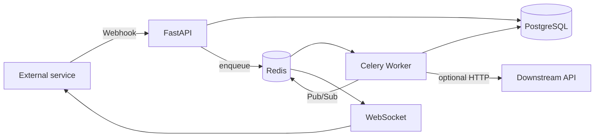

# Async Integration Platform

[](https://github.com/rokerblym/async-integration-platform/actions)

Portfolio-grade event-driven backend using **FastAPI, PostgreSQL, Celery, Redis, SQLAlchemy, Alembic, Docker and WebSockets**.

## Architecture



## Features

- idempotent webhook ingestion
- optional HMAC-SHA256 signature verification
- durable PostgreSQL event/job state
- Celery + Redis background jobs
- exponential retries on downstream HTTP failure
- WebSocket live job updates
- async SQLAlchemy API layer
- Alembic migrations
- Docker Compose
- pytest
- GitHub Actions CI

## Quick start

```bash
chmod +x setup.sh
./setup.sh
docker compose up --build
```

Swagger: `http://127.0.0.1:8001/docs`

## Demo

```bash
curl -X POST http://127.0.0.1:8001/webhooks/orders   -H "Content-Type: application/json"   -H "Idempotency-Key: demo-order-001"   -d '{"order_id":"ORD-1001","status":"paid","amount":45000,"currency":"KZT","customer_id":"CUST-10"}'
```

Re-send the same idempotency key and the API returns the same event/job instead of creating duplicates.

WebSocket updates are available at:

`ws://127.0.0.1:8001/ws/jobs/<JOB_ID>`

`DOWNSTREAM_URL` is optional. When unset, the worker uses demo mode. Only configure endpoints you own or are authorized to use.
